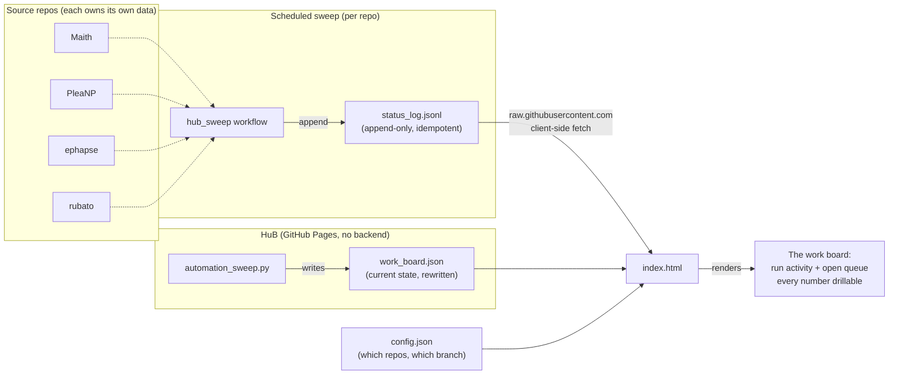

# HuB — the work board

A read-only, static dashboard that answers two questions about a portfolio of
agent-worked repos: **is the machine running?** and **is work getting done?**
It fetches each tracked repo's `status_log.jsonl` plus a current-state
`work_board.json`, and renders run activity and the open queue. Two files
(`index.html`, `config.json`) served by GitHub Pages. No build step, no backend,
no database.

Its one design rule is **no orphan numbers**: every number on the page answers
its own follow-up question by drilling into the records behind it — the issue,
the run, or the snapshot line it came from. A count that cannot be traced to a
record does not ship.

This is a **mirror**: it only fetches and displays. Source repos own their own
`status_log.jsonl` and write it themselves. See
[`HUB_AGENT_HANDOFF.md`](HUB_AGENT_HANDOFF.md) for the architecture and its
rationale, and [`PM_STATUS_FRAMEWORK.md`](PM_STATUS_FRAMEWORK.md) for the record
schema every source repo must match.

## How it works



Each source repo runs the same `hub_sweep` workflow on a schedule. It appends one
line to that repo's own `status_log.jsonl` (no change on a no-op run, so the log
is append-only and never double-counts). HuB then reads every log directly from
`raw.githubusercontent.com` in the browser — no server, no aggregation step. A
repo becomes visible by adding one entry to `config.json`.

HuB's own `automation_sweep.py` does the cross-repo aggregation a browser cannot:
it reads each repo's issue comments and issue labels over the GitHub API (with a
token, server-side, once per sweep) and writes the result to `work_board.json` in
this repo. The page then fetches that one file. This is what keeps the page
inside the unauthenticated rate limit — see "Why this repo writes its own log".

## Tracked repos

`config.json` currently tracks four public source repos plus this repo's own
automation log:

| Repo | Owner / repo | Branch | Publishes |
|---|---|---|---|
| Maith | `philipdallen/Maith` | `status` | `flow` |
| PleaNP | `philipdallen/PleaNP` | `main` | `flow` |
| Ephapse | `philipdallen/ephapse` | `main` | `flow` |
| Rubato | `philipdallen/rubato` | `main` | `flow` |
| Automation | `philipdallen/HuB` | `main` | `automation` + `work_board.json` |

Adding a repo is one addition to the `repos` array. Note that
`raw.githubusercontent.com` only serves **public** repos to an unauthenticated
client-side fetch, so a private repo cannot be added.

Source repos still commit `status/trl.json` for their own READMEs, but HuB no
longer renders `trl` — see "What the work board removed".

### Branches

The `branch` field is the branch each source repo's sweep workflow writes to,
which is the branch its log actually lives on — not necessarily the repo's
default. Read the live value from `config.json`; the table above is a snapshot
and `config.json` wins. Pointing an entry at a branch with no
`status_log.jsonl` makes that tab read amber, which `tools/validate_config.py`
catches in CI.

## The work board

The page leads with three sections, in order. Every number in them links to the
records behind it.

### 1. Header strip — "Is the machine running?"

Last sweep time (relative; red past 6h stale), runs in the last 24h (total plus a
per-repo breakdown), claims currently held, and stale claims (amber when non-zero).
Sourced from the newest `status_log.jsonl` line's `automation` block and the
`work_board.json` claims block. The last-sweep figure links to the log it
summarised; the runs figure links to the recent-runs table below; each repo in
the breakdown links to its issue list. The claim counts are read from the
`claims/` files, so each links to that repo's `claims/` directory — the records
behind the number, not the `status:claimed` label list, which can disagree with
the files (a repo may hold a lock without carrying the label). With no repo
holding a `claims/` mechanism, both claim stats render as an em dash, not `0`.

### 2. Activity — "Is work getting done?"

- **Runs/day chart**, per repo, last 30 days. Run-ids appear verbatim in agent
  comments as `run=YYYYMMDD-HHMM-xxxx`; the id encodes its own UTC start, so no
  extra API call is needed to date it. The chart is a stacked bar per day, so an
  idle day reads as a short bar rather than a missing point.
- **Recent runs table** (last 15): repo, issue, run-id, duration, outcome. Each
  row links to the issue. Duration is the done comment's time minus the id's
  encoded start; an unmatched run shows an em dash, never `0`.

### 3. Queue — "What's open?"

- Per repo: **available** (claimable now), **claimed**, **blocked-needs-input**
  (needs Phil), and **on hold** (the auditor's promotion queue, shown separately
  because it is not a "needs input" item). Each count links to that repo's
  filtered GitHub issue list.
- **Needs you** panel: every `status:blocked-needs-input` and `needs:human` issue
  across all repos, oldest first. This is Phil's action list.

Counts come from open issues only (`state=open`), so a closed issue still
carrying a stale `status:` label is excluded by construction. A repo whose issues
could not be read is omitted from the queue entirely, rather than shown as an
empty queue — the em-dash rule applied to a whole row.

### Kept as-is

The Snapshot log (last 12, newest first) and per-repo cards with links to each
repo and its README. The per-repo cards carry the same rule: each of their six
`flow` stats (open, available, claimed, blocked, awaiting review, closed in 30d)
links to the issue records behind it, and the board-derived queue line links each
of its four counts. A stat with no measured value reads as an em dash and is not
a link, because there is nothing to drill into.

## What the work board removed

- **TRL bars and the mean-TRL trend line.** Three independent reasons: the metric
  misfires on research repos (ephapse's "Candidate generator: 2" exists *because*
  its headline result was an honest null, so the dashboard graphed good science
  as stagnation); none of the log records carried a `trl` key, so the panels were
  fed by nothing; and it answers "how mature?" when the question is "is work
  getting done?". Source repos may still render TRL in their own READMEs, where
  it is informative for artifact-shipping goals like rubato.
- **Derived flow judgments** — `blocked_ratio` colour thresholds and
  `cycle_time_median_hours` as a headline. The raw counts remain (they *are* the
  queue); a colour-coded verdict with no drill-down does not.

## The Automation tab

The source-repo tabs report a repo's own `flow` snapshot and link to its board
queue. The Automation tab is the work board itself, and is written by this repo
rather than a source repo.

`automation_sweep.py` derives it from public data on a schedule and writes two
files:

- **`status_log.jsonl`** — one small appended line per sweep (the `automation`
  block above). Append-only, idempotent (no append when the computed summary is
  unchanged, unless `--force`).
- **`work_board.json`** — the current state: `runs_by_day`, `runs_24h_by_repo`,
  `recent_runs`, `agent_minutes_by_day`, `queue`, `needs_you`, `claims`. Rewritten
  in place, never appended, so it cannot grow without bound.

The split matters. A single line carrying the full board measured ~12 KB against
the old ~370 B line; at ~5 appends/day that is ~22 MB/year of append-only history
that every visitor downloads on every load. The accumulating file stays tiny; the
current-state detail lives where it does not accumulate.

What the sweep reads, all from public endpoints:

- **Run activity** — run-ids in agent comments. The same id seen in two repos
  counts once.
- **Run durations** — matched from the id to the run's done/close comment.
- **Real WIP** — `claims/N.claim` files, the actual lock. The published
  `flow.wip` counts the `status:claimed` *label*, a different number that can read
  0 while work is in flight.
- **Stale claims** — a claim file whose issue is already CLOSED. Nothing releases
  the lock on close, so these accumulate and mislead any claim-counting reader.
- **Queue and "needs you"** — labels read from the same issue payload the sweep
  already fetched, so no new API surface.

**Deliberately absent: failure rate and idle rate.** A failed run dies before it
comments, so it leaves no public trace — only runs that reached the point of
commenting are visible. Those two numbers need the automation API and a
credential, which a static public page cannot hold. An absent field renders as
an em dash, never as 0.

### Why this repo writes its own log

`index.html` is static: no backend, no credentials, and it can only fetch over
the public CDN. It cannot call the GitHub API — the unauthenticated budget is 60
requests/hour *per visitor IP*, and a single page load that fetched comments
would spend about a third of it, breaking the page for everyone behind a shared
address. So the numbers must be precomputed by a scheduled job, which is
`automation_sweep.yml`. It runs with `contents: write` and writes exactly two
files, both in this repo (`status_log.jsonl`, `work_board.json`). The page stays
read-only to visitors.

## Deployment

1. Repo settings → Pages → Deploy from a branch → `main`, `/ (root)`.
2. No build step. `index.html` and `config.json` live at the repo root.
3. Open the page and confirm each tab's dot resolves from grey (loading) to a
   colour: teal = data found, amber = no `status_log.jsonl` yet (expected today),
   rose = fetch error (repo private, branch typo, network). Amber and rose are
   bugs, not states to accept.
4. Confirm the Automation tab renders the work board (header strip, runs chart,
   recent runs, queue, needs-you). If it shows "could not be read", the sweep has
   not written `work_board.json` yet — run `automation_sweep.py` once locally, or
   wait for the next scheduled sweep.

## Validation

`config.json` is the one file whose corruption is invisible: a typo in an owner,
repo, or branch field degrades a tab to amber without failing anything. CI closes
that hole.

```bash
python3 tools/validate_config.py
```

`tools/validate_config.py` parses `config.json`, then fetches each tracked
repo's `status_log.jsonl` and asserts it exists, is non-empty, and ends in valid
JSON. It exits non-zero if any tracked repo does not resolve, so the failure
surfaces in CI rather than in a browser tab. The `CI` workflow runs it on every
push and pull request.

`automation_sweep.py --selftest` proves the sweep's own logic can fail — run
duration matching, the rolling 24h window, the 30-day series, queue counting, the
oldest-first needs-you sort, and the em-dash rule. The `CI` workflow runs it too.
A check that cannot be shown to fail is not a check; when adding one, verify it
by mutation (break the logic, confirm the selftest reports FAIL, then restore).

## Current state

All four source repos have the sweep extension (`tooling/hub_sweep.py`, or
`tools/hub_sweep.py` in rubato) and the scheduled `hub_sweep` workflow installed.
The workflow is idempotent: on a run with no change it appends nothing.

The work board is written by this repo's own `automation_sweep.yml` and
`automation_sweep.py`, which appends the `automation` summary to
`status_log.jsonl` and rewrites `work_board.json`. Both this sweep and the config
validator run a selftest in CI (`automation_sweep.py --selftest`,
`tools/validate_config.py --self-test`), because a check that cannot be shown to
fail is not a check.